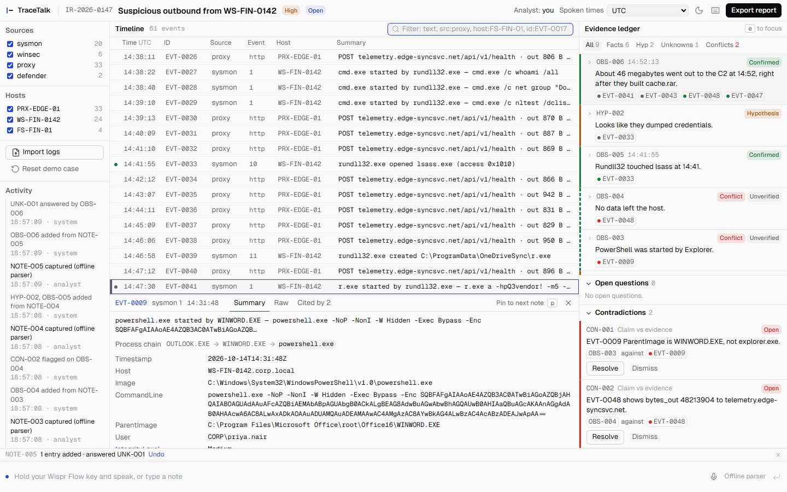
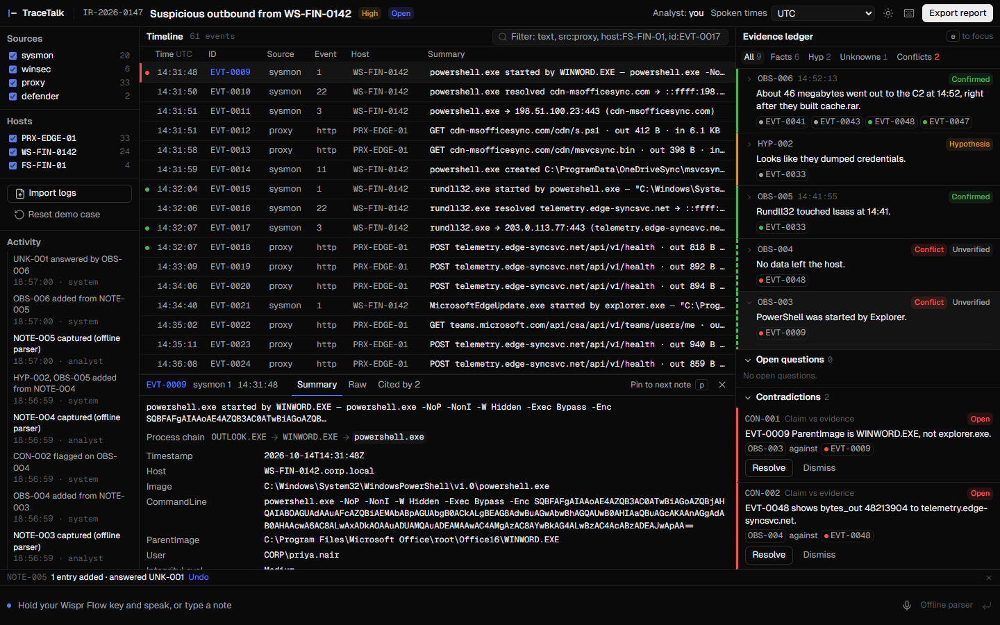
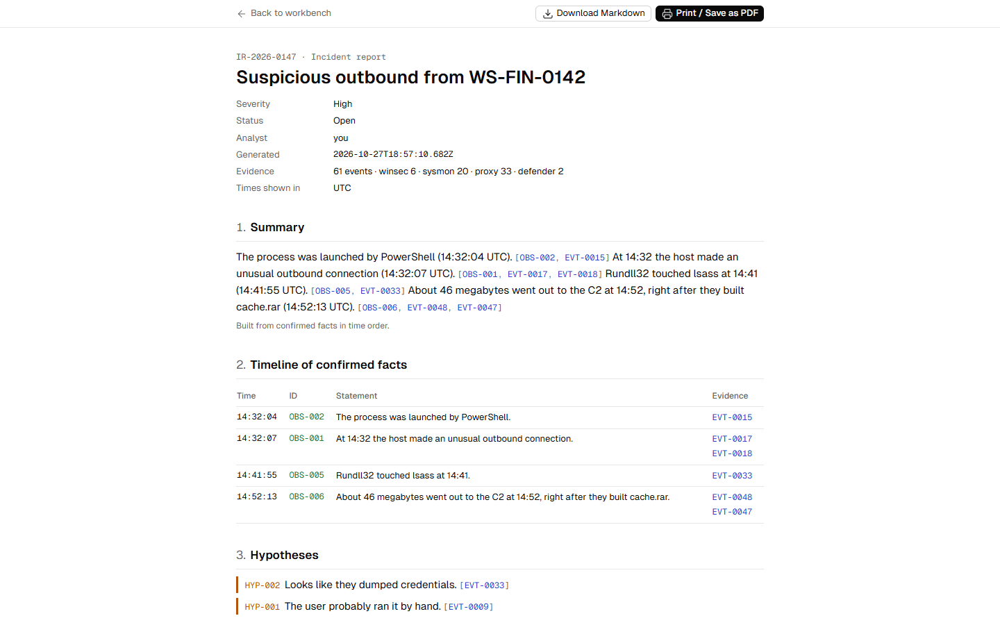
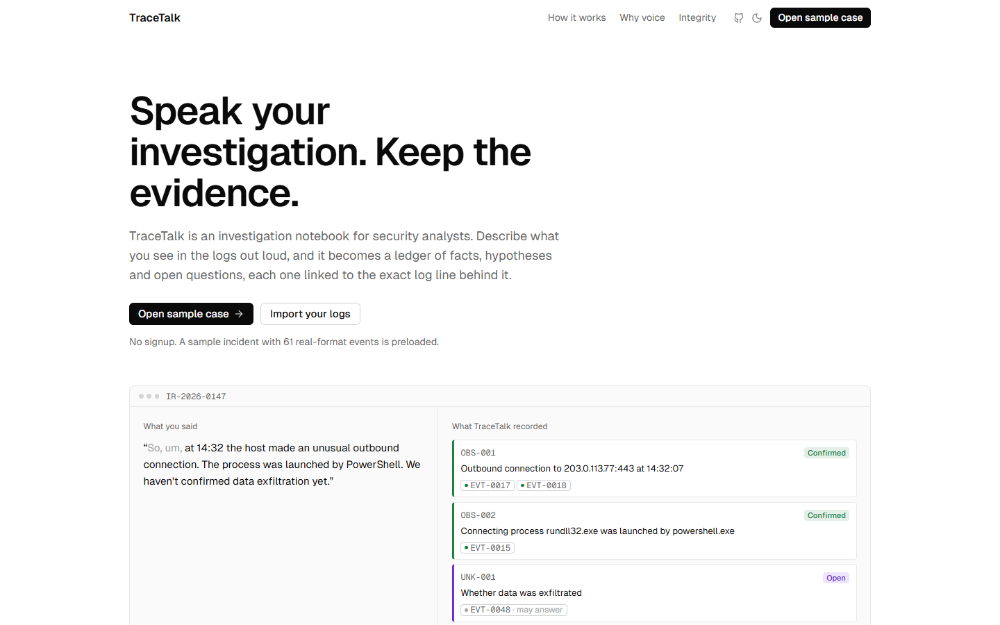

<h1 align="center">TraceTalk</h1>

<p align="center">
  <strong>Speak your investigation. Keep the evidence.</strong><br/>
  A voice-first notebook for security analysts. Say what you see in the logs and it becomes a ledger of facts, hypotheses and open questions, each one linked to the exact log line behind it.
</p>

<p align="center">
  
  
  
  
</p>

<p align="center">
  Built for <a href="https://www.wemakedevs.org/wispr">No Hands: The Wispr Challenge</a> by WeMakeDevs × Wispr Flow.
</p>

<picture>
  <source media="(prefers-color-scheme: dark)" srcset="docs/screenshots/workbench-dark.png" />
  
</picture>

---

## The problem

When you're tracing an attack, your hands and eyes are on the logs. Switching to a notes app breaks focus, so notes get written later, from memory. By the time the report is written, confirmed facts and educated guesses have blurred together. A reviewer who reads "data was exfiltrated" can't tell which log line proved it, or whether anything did.

TraceTalk keeps you in the logs. You select events, speak, and every statement lands in a ledger that shows what is **confirmed by a log line**, what is a **hypothesis**, and what is still **unknown**. Anything that conflicts with the logs, or with something you said earlier, is flagged on the spot.

> **TraceTalk never invents findings.** It only structures what you said and checks it against the evidence.

## What you get

| | |
|---|---|
| **Dictate, don't type** | Works with [Wispr Flow](https://wisprflow.ai) system-wide. Hold your Flow key, speak, and clean text lands in the note box. Browser speech input and typing also work. |
| **Facts, hypotheses, unknowns** | One note becomes separate ledger entries. "Probably" and "looks like" become hypotheses; "we haven't confirmed" becomes an open question. |
| **Evidence you can click** | Each entry cites the events behind it, with the exact field values it matched (`ParentImage = …\powershell.exe`). Hover an entry and its rows light up in the timeline. Click an event to see every entry that cites it. |
| **Contradiction flags** | "PowerShell was started by Explorer" next to a log showing Word started it? Flagged, with the field and value. Resolve or dismiss each one with a note. |
| **A report a reviewer can trust** | Every sentence carries citations. The appendix has the raw JSON of each cited event and every note you dictated, verbatim. Export as Markdown or print to PDF. |
| **Light and dark** | Black, white and one blue. Follows your system, with a toggle. |

<table>
  <tr>
    <td width="50%"></td>
    <td width="50%"></td>
  </tr>
  <tr>
    <td align="center"><sub>A claim that disagrees with the logs, with matched fields</sub></td>
    <td align="center"><sub>The report: every claim cites its evidence</sub></td>
  </tr>
</table>

<picture>
  <source media="(prefers-color-scheme: dark)" srcset="docs/screenshots/home-dark.png" />
  
</picture>

## Try it

Open the app and you land in a preloaded incident (`IR-2026-0147`, 61 events across Sysmon, Windows Security, a web proxy and Defender). Type or speak these in order:

1. *At 14:32 the host made an unusual outbound connection. The process was launched by PowerShell. We haven't confirmed data exfiltration yet.*
   → two confirmed facts, linked to the events that show them, and one open question.
2. Shift-click **EVT-0009** to pin it, then: *PowerShell was started by Explorer, so the user probably ran it by hand.*
   → a hypothesis, and a **contradiction**: the log shows Word started PowerShell.
3. *No data left the host.*
   → an unverified fact, and a **contradiction** against a 46 MB upload in EVT-0048.
4. *Looks like they dumped credentials, rundll32 touched lsass at 14:41.*
   → a hypothesis, plus a confirmed fact linked to EVT-0033.
5. *Confirmed. About 46 megabytes went out to the C2 at 14:52, right after they built cache.rar.*
   → a confirmed fact, and the open question from step 1 is marked **answered**.

Then resolve both contradictions with a short note, open **Export report**, and download the Markdown.

## How the integrity check works

The parser, whether the rule-based one or a model, proposes evidence links. Each link must quote a field name and a value from the event. Before anything is stored:

1. The event must be one of the candidate events sent with the note.
2. Every quoted value must appear verbatim (case-insensitive) in that field of the raw event JSON. If it doesn't, the link is dropped and the activity trail records `1 evidence link rejected: value not found in EVT-00xx`.
3. A fact is **Confirmed** only when at least one valid `supports` link exists. Otherwise it is **Unverified**.
4. An unverified fact can never mark an open question as answered.
5. A contradiction must cite a real entry and a real event or earlier entry, or it is dropped.

This runs on the server for model output and again in the browser before the ledger is written ([`lib/validate.ts`](lib/validate.ts)). The report summary follows the same rule: a sentence citing an ID that doesn't exist is removed.

## Run it

```bash
npm install
npm run dev      # http://localhost:3000 — the homepage; "Open sample case" goes to the workbench
npm test         # runs the five demo lines through the offline parser and checks every quoted value
npm run build
```

Node 20 or newer. No database, no login; case state lives in your browser's localStorage.

### Optional: a model parser

With no configuration TraceTalk uses its deterministic rule-based parser, and everything above still works, including both planted contradictions. To use a model instead, set any OpenAI-compatible chat completions API:

```bash
cp .env.example .env.local
```

| Variable | Example |
|---|---|
| `LLM_BASE_URL` | `https://api.groq.com/openai/v1` |
| `LLM_API_KEY` | your key |
| `LLM_MODEL` | `llama-3.3-70b-versatile` |

Model output is validated with `zod` and the integrity check above. If the call fails, or the output doesn't match the schema after one retry, the note is parsed with the offline rules and the capture bar says so.

### Deploy

Import the repo in Vercel. The only server code is `app/api/parse/route.ts`. Add the three variables above if you want the model parser.

## Using it with Wispr Flow

TraceTalk has no speech engine of its own, on purpose. Wispr Flow works in any text box, so the note box is just a text box: hold your Flow key (Ctrl + Win on Windows, Fn on Mac by default), speak, release, press Enter.

Two tips from building the demo:

- Add `rundll32`, `lsass`, `PowerShell`, `cache.rar` and `exfiltration` to Flow's dictionary. The parser matches exact process and file names.
- Say times with a colon: "14:32". A quick glance at the text before pressing Enter catches the odd mis-hearing.

## Project layout

```
app/                     Next.js routes: / (homepage), /case/[id] (workbench), /case/[id]/report, /api/parse
components/              Workbench, Timeline, Ledger, EventDrawer, CaptureBar, Report, home/*
content/home.ts          All homepage copy
lib/
  ingest.ts summarize.ts   JSONL → events with one-line summaries
  retrieval.ts time.ts     Candidate retrieval: spoken times, entities, aliases
  offlineParser.ts         Deterministic parser and the built-in contradiction rules
  validate.ts schema.ts    The integrity check and zod schemas
  caseOps.ts store.ts      Pure case operations and per-case persisted stores
  report.ts                Report, indicators, Markdown export
data/                    The sample case (JSONL)
scripts/demo-check.ts    The demo script as an automated test
docs/specs/              The build specs this project was made from
DECISIONS.md             Where the spec was open, and what I chose
```

## The sample case

61 synthetic events from one finance workstation. IPs use RFC 5737 documentation ranges, and domains and hashes are invented, so don't visit them.

| Time (UTC) | What happened | Events |
|---|---|---|
| 14:16–14:29 | Outlook saves `Invoice_Oct2026_Vendor4471.docm`; Word opens it | EVT-0007, EVT-0008 |
| 14:31:48 | Word spawns hidden, encoded PowerShell | EVT-0009 |
| 14:31:50–59 | PowerShell downloads a stager and writes `msvcsync.dll` | EVT-0010 – EVT-0014 |
| 14:32:04–07 | PowerShell launches `rundll32 msvcsync.dll`, which connects to 203.0.113.77:443 | EVT-0015 – EVT-0018 |
| 14:38–14:39 | Discovery: `whoami`, `net group "Domain Admins"`, `nltest` | EVT-0027 – EVT-0029 |
| 14:41:55 | rundll32 opens lsass.exe (0x1010) | EVT-0033 |
| 14:47–14:49 | A renamed RAR archives `Vendor Payments FY26` into `cache.rar` | EVT-0039, EVT-0041, EVT-0043 |
| 14:52:13 | 48,213,904 bytes POSTed to `/api/v1/upload` | EVT-0047, EVT-0048 |
| 14:55–14:56 | Failed NTLM logons to FS-FIN-01 as `svc_backup` and `administrator` | EVT-0052 – EVT-0056 |
| 15:04 | Defender quarantines `msvcsync.dll` | EVT-0060, EVT-0061 |

You can bring your own logs: **Import logs** takes `.jsonl`, one JSON object per line with `id`, `timestamp`, `source`, `host` and `event_id`.

## Status

Working today: the workbench, the offline and model parsers, the integrity check, contradictions, the report with Markdown export, JSONL import, and the homepage in light and dark.

Still on the list ([`docs/specs/PROMPT_v2_UI.md`](docs/specs/PROMPT_v2_UI.md), steps 3–5): hiding routine events and collapsing repeated beacon rows so the key events stand out, signal tags like *Encoded command*, a larger floating note box, and an accessibility pass.

## Keyboard

`/` note box · `j` `k` move through the timeline · `Enter` open the drawer · `p` pin a row · `e` ledger · `f` filter · `Esc` close · `?` all shortcuts

## Built with

Next.js 15 (App Router), React 19, TypeScript (strict), Tailwind CSS, Zustand, `@tanstack/react-virtual`, `zod`, Geist, and `lucide-react`. Wispr Flow and WeMakeDevs logos are used as provided on the challenge page.

---

<sub>Made by <a href="https://github.com/akshitag001">Akshit</a>. TraceTalk is a hackathon project: the sample data is synthetic, and it is not a substitute for your SIEM.</sub>
