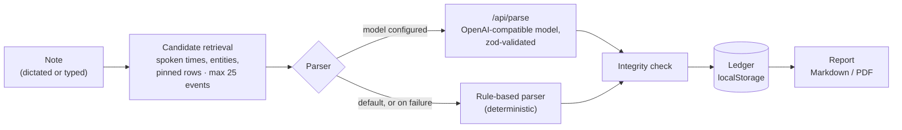

# TraceTalk

**Speak your investigation. Keep the evidence.**

TraceTalk is an investigation notebook for security analysts. You describe what you see in the logs, out loud or typed, and each statement becomes a fact, a hypothesis or an open question, linked to the exact log lines behind it. Claims the logs don't back stay unverified, and claims the logs contradict are flagged.

[**Live demo**](https://akshitag001.github.io/TraceTalk/) · [How it works](#how-it-works) · [Run locally](#run-locally) · [Design decisions](#design-decisions) · [Limitations](#limitations)

[](https://github.com/akshitag001/TraceTalk/actions/workflows/pages.yml)

<picture>
  <source media="(prefers-color-scheme: dark)" srcset="docs/screenshots/workbench-dark.png" />
  
</picture>

## Why

During an incident, an analyst's eyes and hands are on the logs. Notes get written afterwards, from memory, and by the time the report is drafted, confirmed findings and educated guesses have merged. A reviewer who reads "data was exfiltrated" has no way to tell which log line showed it, or whether any did.

TraceTalk keeps the analyst in the logs and keeps the reasoning attached to the evidence:

- **Statements are classified.** "Probably" and "looks like" become hypotheses. "We haven't confirmed" becomes an open question. Plain assertions become facts.
- **Facts must be backed.** A fact is *confirmed* only when a log event contains the value it relies on. Otherwise it stays *unverified*.
- **Conflicts surface immediately.** "PowerShell was started by Explorer" next to an event whose `ParentImage` is `WINWORD.EXE` produces a contradiction that cites the field and value.
- **The report is auditable.** Every sentence cites entry and event IDs. The appendix holds the raw JSON of each cited event and every note, verbatim.

TraceTalk never adds findings of its own. It only structures what the analyst said and checks it against the evidence.

## How it works



1. **Candidate retrieval** ([`lib/retrieval.ts`](lib/retrieval.ts)). Spoken times such as "14:32" or "2:32 pm" are resolved against the case date and time zone, and events within ±90 s are selected. Entities are extracted too: IPs, domains, file names, hosts, users, sizes like "46 megabytes", and aliases like "word" → `WINWORD.EXE`. Pinned rows always count. The top 25 events by a simple score become the only events the parser may cite.
2. **Parsing.** The rule-based parser ([`lib/offlineParser.ts`](lib/offlineParser.ts)) splits the note into statements, classifies them and links evidence. If a model is configured, it gets the same candidates and a strict system prompt ([`lib/prompts.ts`](lib/prompts.ts)), and its output must match a `zod` schema. An invalid response gets one retry, then the rule-based parser takes over.
3. **Integrity check** ([`lib/validate.ts`](lib/validate.ts)). This applies to both parsers:
   - Every evidence link must point at a candidate event.
   - Every quoted `field = value` must appear verbatim (case-insensitive) in that field of the raw event JSON. Links that fail are dropped and logged in the activity trail.
   - A fact is confirmed only with at least one valid `supports` link.
   - An unverified fact cannot mark an open question as answered.
   - A contradiction must cite a real entry and a real event or earlier entry.

   The check runs on the server for model output and again in the browser before anything is stored.

## Features

- **Timeline:** filters by source, host and text (`src:proxy`, `host:FS-FIN-01`, `id:EVT-0017`), virtualized rows, and a drawer with key fields, the process chain and raw JSON.
- **Provenance both ways:** hover a ledger entry and the events it cites light up. Open an event and see every entry that cites it.
- **Pinning:** Shift-click rows to attach them to your next note.
- **Ledger:** filters by kind, matched fields per link, editing with a recheck, open questions that get answered by later facts, and contradictions resolved or dismissed with a note.
- **Undo per note:** removes everything a note produced.
- **Report:** a summary built only from confirmed facts, a timeline, hypotheses, open questions, contradictions, indicators extracted from linked events, the reasoning trail and a raw-event appendix. Download as Markdown, or print to PDF.
- **Import:** your own `.jsonl` logs, validated line by line, into the current case or a new one.
- **Light and dark themes**, keyboard shortcuts (`?`), and no login.

<table>
  <tr>
    <td width="50%"></td>
    <td width="50%"></td>
  </tr>
  <tr>
    <td align="center"><sub>A claim that conflicts with the logs</sub></td>
    <td align="center"><sub>The report: every claim cites its evidence</sub></td>
  </tr>
</table>

## Try it

The [live demo](https://akshitag001.github.io/TraceTalk/) opens with a sample incident: 61 events from one workstation across Sysmon, Windows Security, a web proxy and Defender. Enter these in order:

| # | Note | Result |
|---|---|---|
| 1 | *At 14:32 the host made an unusual outbound connection. The process was launched by PowerShell. We haven't confirmed data exfiltration yet.* | Two confirmed facts (EVT-0017/0018, EVT-0015) and an open question |
| 2 | Pin **EVT-0009** (Shift-click), then: *PowerShell was started by Explorer, so the user probably ran it by hand.* | A hypothesis, and a contradiction: `ParentImage` is `WINWORD.EXE` |
| 3 | *No data left the host.* | A contradiction against a 48,213,904-byte upload in EVT-0048 |
| 4 | *Looks like they dumped credentials, rundll32 touched lsass at 14:41.* | A hypothesis and a confirmed fact (EVT-0033) |
| 5 | *Confirmed. About 46 megabytes went out to the C2 at 14:52, right after they built cache.rar.* | A confirmed fact, which answers the open question from note 1 |

## Run locally

Requires Node 20+.

```bash
npm install
npm run dev     # http://localhost:3000
npm test        # runs the five notes above through the rule-based parser and checks every stored quote
```

### Configuration (optional)

With no configuration, the rule-based parser is used. To add a model, set any OpenAI-compatible chat completions endpoint in `.env.local`:

```bash
LLM_BASE_URL=https://api.groq.com/openai/v1
LLM_API_KEY=...
LLM_MODEL=llama-3.3-70b-versatile
```

### Deployment

| Target | What you get | How |
|---|---|---|
| **GitHub Pages** (the live demo) | A static export. No server, so notes are parsed by the rule-based parser in the browser. | Push to `main`. [`pages.yml`](.github/workflows/pages.yml) runs `npm test`, builds with `GITHUB_PAGES=true` and deploys. One-time setup: Settings → Pages → Source → GitHub Actions. |
| **Vercel** | The full app, including the model parser. | Import the repo and set the three variables above. |

## Design decisions

| Decision | Why |
|---|---|
| **The parser proposes; the validator decides** | A model can be wrong with confidence. Requiring a verbatim quote from the event turns "the model says so" into something checkable, and the same check applies to the rule-based parser. |
| **A deterministic parser first, a model second** | The app must work with no API key and no network, and a live demo can't depend on a third-party service. A model, when configured, widens what's understood without changing the guarantees. |
| **Retrieval before parsing** | It bounds the context to 25 events and limits what can be cited. An event the parser never saw can't be linked. |
| **Notes are stored verbatim** | Entries are rewritten into neutral sentences, so the original words are kept to show how each conclusion was reached. |
| **State in the browser** | No backend, accounts or database, which makes it simple to deploy and keeps logs on the analyst's machine. The cost is no sync or collaboration (see below). |
| **Static hosting stays first-class** | Only the API route is excluded from the static build. Imported cases, whose IDs the build can't know, are rendered by a client-side 404 shell ([`app/not-found.tsx`](app/not-found.tsx)). |

Smaller choices made where the spec was open are recorded in [`DECISIONS.md`](DECISIONS.md).

## Limitations

- **The rule-based parser is pattern-based.** It handles time references, sizes, known process aliases, who-launched-whom claims, "no data left"-style claims, and two facts giving the same process different IPs. Contradictions outside those patterns need the model parser.
- **The model path hasn't been evaluated.** Its schema validation, integrity check and fallback are tested. Its accuracy across real notes and models is not.
- **The log format is simplified.** Sysmon, Windows Security, proxy and Defender events are expected as flat JSONL objects, not raw EVTX or vendor exports.
- **Single analyst, single browser.** Cases live in `localStorage`. Clearing site data deletes them, and there is no sharing.
- **The sample data is synthetic,** and so is the incident. TraceTalk is a notebook, not a SIEM or a detection engine.

## Roadmap

- [ ] Hide routine events (Teams, OneDrive, Office 365) and collapse repeated beacon rows into one expandable row
- [ ] Signal tags on events, such as *Encoded command*, *Office spawned shell* and *LSASS access*
- [ ] Decoded view for encoded PowerShell in the event drawer
- [ ] A larger floating note box with pinned-event chips
- [ ] Accessibility pass (Lighthouse ≥ 95)

The full plan is in [`docs/specs/PROMPT_v2_UI.md`](docs/specs/PROMPT_v2_UI.md).

## Project layout

```
app/
  page.tsx                  homepage
  case/[id]/                workbench and report routes
  api/parse/route.ts        model parser endpoint (excluded from the static build)
  not-found.tsx             renders imported cases on static hosting
components/                 Workbench, Timeline, Ledger, EventDrawer, CaptureBar, Report, home/
content/home.ts             homepage copy
lib/
  retrieval.ts, time.ts     candidate retrieval: times, entities, aliases
  offlineParser.ts          rule-based parser and contradiction rules
  validate.ts, schema.ts    integrity check, zod schemas
  caseOps.ts, store.ts      pure case operations, per-case persisted stores
  ingest.ts, summarize.ts   JSONL ingestion and one-line event summaries
  report.ts                 report model, indicators, Markdown export
data/                       sample case (JSONL)
scripts/demo-check.ts       end-to-end check of the demo notes
docs/                       screenshots and the original build specs
```

**Stack:** Next.js 15 (App Router), React 19, TypeScript (strict), Tailwind CSS, Zustand, `@tanstack/react-virtual`, `zod`, Geist and Lucide.

## Dictation

TraceTalk has no speech engine. The note box is a plain text field, so any system-wide dictation works. It was built for [Wispr Flow](https://wisprflow.ai): hold the Flow key (Ctrl + Win on Windows, Fn on macOS), speak, release, then press Enter. Browser speech input is available as a fallback.

The rule-based parser matches exact names, so add terms like `rundll32`, `lsass`, `PowerShell` and `cache.rar` to Flow's dictionary, and say times as "14:32".

## Sample incident

| Time (UTC) | What happened | Events |
|---|---|---|
| 14:16–14:29 | Outlook saves `Invoice_Oct2026_Vendor4471.docm`; Word opens it | EVT-0007, 0008 |
| 14:31:48 | Word spawns hidden, encoded PowerShell | EVT-0009 |
| 14:31:50–59 | PowerShell downloads a stager and writes `msvcsync.dll` | EVT-0010 – 0014 |
| 14:32:04–07 | `rundll32` loads the DLL and connects to 203.0.113.77:443 | EVT-0015 – 0018 |
| 14:38–14:39 | Discovery: `whoami`, `net group "Domain Admins"`, `nltest` | EVT-0027 – 0029 |
| 14:41:55 | `rundll32` opens `lsass.exe` (0x1010) | EVT-0033 |
| 14:47–14:49 | A renamed RAR archives `Vendor Payments FY26` into `cache.rar` | EVT-0039, 0041, 0043 |
| 14:52:13 | 48,213,904 bytes POSTed to `/api/v1/upload` | EVT-0047, 0048 |
| 14:55–14:56 | Failed NTLM logons to FS-FIN-01 | EVT-0052 – 0056 |
| 15:04 | Defender quarantines `msvcsync.dll` | EVT-0060, 0061 |

IPs use RFC 5737 documentation ranges. Domains and hashes are invented, so don't visit them.

## Acknowledgements

Built for [No Hands: The Wispr Challenge](https://www.wemakedevs.org/wispr) by WeMakeDevs × Wispr Flow. The Wispr Flow and WeMakeDevs logos are used as published on the challenge page and belong to their owners.

Made by [Akshit](https://github.com/akshitag001).
